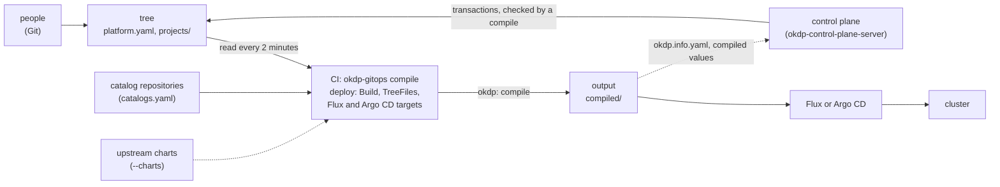
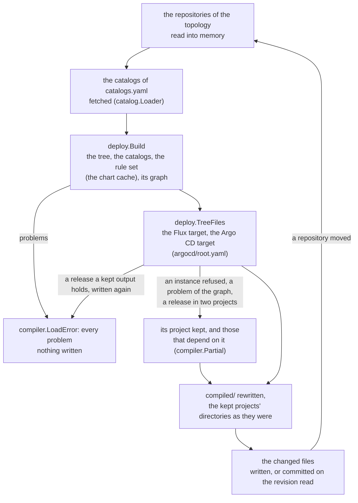

# Architecture

How okdp-gitops works. What it reads and writes is specified in
[the tree](specs/01_layout.md), [the compile](specs/02_compile.md),
[the output](specs/03_output.md), [topologies](specs/04_topology.md) and
[the policy](specs/05_rules.md);
how the tree compiles, in okdp-compiler's
[architecture](https://github.com/OKDP/okdp-compiler/blob/main/docs/00_architecture.md).

## Position in OKDP

OKDP deploys a platform and the services of its projects from Git: the
cluster is never written to directly, a GitOps engine reconciles what is
committed. The tree of the deployments, which people and the control
plane write, is read by okdp-compiler: `platform.yaml`, the projects and
their instances. The output, which the engines read, is what the targets
of okdp-gitops write from it: per instance, an umbrella chart, its values, its
Flux HelmRelease and its Argo CD Application.

[okdp-compiler](https://github.com/OKDP/okdp-compiler) compiles: it
reads the tree, binds each claim to its provider, compiles every
instance with what the others publish, merges its final values as Helm
does, and orders the releases; it reads no upstream chart. okdp-gitops
is what surrounds that: the security set added to the compiler's rule
set and its upstream policy, wired in its compiles
([okdp-compiler-security](https://github.com/OKDP/okdp-compiler-security)),
the render of the upstream charts, the checks of the final values
against the upstream charts (`internal/chartcheck`), the files the
deployers read (`deploy`, `internal/target`), the edits of the tree
(`treeedit`), the chart cache (`chartcache`), and the Git around it. It
checks the parts of the tree out of their repositories (one, or one per
project), fetches the catalog repositories, hands them all to the
compiler, and commits what its targets write under `compiled/`, on the
revision it read. One program writes the output, from the tree only,
whoever changed it: a change made in Git and one made in the console give
the same bytes.

The control plane links the module: it commits the edits of the tree
(package `treeedit`, every rule of an edit and of its check)
through `gitops.Deployments`, Git transactions that apply each edit to
the tree at the latest revisions, check it with the compile of the
whole tree before and after it (`treeedit.Apply`, `Check.Verify`) and
commit its change to the repositories of its paths; it reads the tree
with `treeedit`'s readers, the compile of the tree (each instance's
outcome, the claims bound to each provider), and the output back.
It writes no output: the CI of the output does, every 2 minutes, from
the latest sources.

## Source map

| Path | |
|---|---|
| `cmd/okdp-gitops/main.go` | the binary: the flags of `compile`, the run bounded by `--timeout`, the compiles again when a repository moved |
| `cmd/okdp-gitops/compile.go` | `compilation`: every repository of the topology opened and read into memory, the compile, the writes (in place for a local directory, a commit per Git repository on the revision the compile read), the problems of the kept projects reported |
| `cmd/okdp-gitops/read.go`, `cmd/okdp-gitops/linked.go` | the one reader of the CLI, `readPaths`: the paths of the layout (`Topology.LayoutPaths`) of a repository copied from a `treeedit.Reader`, the snapshot of a Git clone (at a depth of 1, on disk) or `gitops.NewDirReader` of a local directory, a symbolic link recorded, never followed, a file refused by its size before it is read; `linked`, the copy in memory refusing a path through a link as a clone does |
| `cmd/okdp-gitops/topology.go`, `cmd/okdp-gitops/workflow.go` | the io topology of `--tree` and `--output`, the path of a directory in its repository; `okdp-gitops workflow` |
| `cmd/okdp-compile/` | the binary that compiles local directories: its flags, `deploy.Build`, the bindings, refusals and dependencies printed, `--partial`, `--report` |
| `cmd/okdp-gitops/sources.go` | the record of the output, `sources.yaml`: what a compile read (`record`, `writeRecord`), the run that stops when it holds (`upToDate`, the refs listed without a fetch, `listRefs`); the revision a kept project's output is the compile of, reported (`keptSince`, `reportKept`) |
| `deploy/` | `Build`, `compiler.Build` with the standard rule set (`rules.Standard`), `helmvalues.New` (`helmvalues.WithoutRender` with `BuildOptions.SkipRender`) and the security set's `policy.CheckGlobals`, each unless the caller gives another, and with `BuildOptions.Charts` the upstream charts of every `Chart.yaml` of the tree fetched before the compile (`compiler.BuildOptions.Loaded`); `ChartSource`, `Charts`, `StaticCharts`, `NewCharts`, `CoalesceValues`; the targets, `TreeFiles`, the files of a compile, and what reads them back |
| `rules/` | `Standard`, the compiler's mandatory rule set with the security set added (`security.Rules`), and `Or`, a caller's set or it |
| `treeedit/` | the tree read (`ReadSources`, the readers), the edits and their checks (`Apply`, `Check.Verify`), the output as a tree (`OutputTargets`, `OutputFS`, `WriteOutput`) |
| `chartcache/` | the chart cache, a chart source (`Get`, `FS`): a chart pulled once and kept whole, with its archive, bounded (`NewCache`, `NewRepositoryPuller`, `Archive`); `ChartDir`, `chartdir.Of` |
| `internal/chartcheck/` | the final values checked against the upstream charts, which the compiler does not read: `Source` (`Get`, `FS`), `Static`, a cache filled already; `Charts`, the charts of one build (`New`, `Fetch`, `Failed`, `Failures`, `FS`, `Check`); `Coalesce`, Helm's `chartutil.CoalesceValues` |
| `internal/chartdir/` | the layout of a chart cache, `Of` (`<repository without scheme>/<chart>-<version>/<chart>`), and the `helm pull` that fills it by hand, `Pull` |
| `internal/render/` | a chart rendered with its final values (Helm SDK, no cluster), read at its `chartdir.Of`, checked by `internal/helmvalues` (the render's policy) |
| `internal/target/` | the targets: `helm` (`Target`, values; `Umbrella`, a chart), `flux`, `argocd`, and what they share (a project's manifests, the directories, the checks of their options) |
| `internal/output/` | the files of a tree for its targets, the projects kept (`compiler.Partial`) and what is re-derived of them |
| `internal/helmvalues/` | `compiler.FinalValues` with the security set's `policy.UpstreamCheck`, then `Charts.Check`, then `CheckRendered` and `policy.PlainUpstream`, the compile running the hook `finalValues` on what it returns; `CheckRendered`, the charts a project gives upstream values to rendered, refused when they could not be fetched, their manifests through `compiler.CheckObjects` |
| `internal/outdir/`, `internal/dirfs/`, `internal/helmtest/` | the output directory of `okdp-compile` and its mark; the directories it reads, bounded, no symbolic link followed; the tests' Helm |
| `gitops/tree.go` | `Compiler`: the catalogs of `catalogs.yaml` opened (`treeedit.ReadCatalogRepositories`), the tree read (`treeedit.ReadSources`, bounded: `platform.yaml`, `catalogs.yaml`, whose menu the compile checks, `projects/`; `MaxTreeFileSize`, `MaxTreeSize` are its bounds under the names of this package), `deploy.Build` (with the chart source, `deploy.NewCharts` for each build); the compiles kept (`memoKey`), but one with a chart that could not be fetched, which is logged per chart and per instance key; a `catalogs.yaml` checked as the compile checks it (`CheckCatalogs`, `treeedit.CheckCatalogs`) |
| `gitops/output.go` | `WriteCompiled`: the compile, the targets of the output (`treeedit.OutputTargets`: `argocd/root.yaml` read by `deploy.ReadArgoRoot`), `deploy.TreeFiles` over `treeedit.OutputFS` (`compiled/` of a transaction as an `fs.FS`), with the charts of `Compiler.Charts` that the withdrawal of a refused instance renders, and `compiled/` rewritten (`treeedit.WriteOutput`), the projects with a problem kept as they were (`compiler.KeptProject`); no choice of files or targets is made here, they are `deploy`'s |
| `gitops/deployments.go` | `Deployments`: an edit of `treeedit` committed (`Apply`: `treeedit.Apply` in a transaction, the compile of the tree before and after the change, the warnings logged, one commit per repository named after the edit, `NewCommit`), a method per edit and per reader, each a call of `treeedit` in a transaction or a view; a project of a split topology, its repository created first (`ForgejoClient`, `Topology.ProjectRepository`) |
| `gitops/layout.go` | the output's names, `CompiledDir` (`treeedit.CompiledDir`), `SourcesFile` |
| `gitops/store.go` | `Store` (its reads a `treeedit.Reader`), `Tx` (a `treeedit.Writer`); the errors of Git (`ErrConflict`, `ErrMoved`; `ErrSymlink` and `ErrTooLarge` are `treeedit` errors); the commits (`Commit`, `NewCommit`, `Program`) |
| `gitops/git_store.go`, `gitops/memory_store.go`, `gitops/dir_reader.go` | `GitStore`, a Git remote through go-git (its whole history, or the last commits, `Depth`); `MemoryStore`; `NewDirReader`, a local directory read as a clone is (the same transaction over the billy filesystem of the directory, `fsTx`: a link refused, a file over the bound refused by its size) |
| `gitops/topology.go`, `gitops/repositories.go` | the topology file, the repository of a project (`Project`, with its entry of `projects.yaml`, `treeedit.ProjectsList`; `ProjectRepository`, the name of a new one); `Repositories`, the paths of the tree routed to the store of their part, the writes across repositories; `Topology.LayoutPaths`, the paths of a repository the layout routes to it |
| `gitops/auth.go`, `gitops/forgejo.go`, `gitops/workflow.go`, `gitops/charts.go` | the credentials, one provider for every path (`Credentials`: a directory or a token, and the `http://` hosts allowed, `NewCredentials`; the compile's from the environment, `CredentialsFromEnv`; a repository's, `For`; a catalog's, `Catalogs`; the Forgejo API's check, `CheckInsecureHTTP`); the repository of a new project (`ForgejoClient`); the workflow of the output (`OutputWorkflow`, `OutputWorkflowWith`), its topology in it, and the runner it needs; the chart puller of the credentials (`NewChartPuller`: their CA, the hosts allowed at a private address or over plain HTTP, `ChartHosts`, `GITOPS_PRIVATE_CHART_HOSTS`, `GITOPS_INSECURE_CHART_HOSTS`) |
| `catalog/` | the catalogs of `catalogs.yaml` (`treeedit.CatalogRepository`), read from Git at their ref, that ref only, or from a directory (`Loader`); their services, versions, packages and contracts are okdp-compiler's index of them (`Catalogs.Index`, `compiler.LoadCatalog`) |
| `internal/buildinfo/` | the program's name and version, for the co-author trailer of the commits a user authors |
| `examples/` | six trees and what `okdp-compile` writes of them (`TestExample`, `make example`). `input/db/` is the real tree format on purpose: `projects/<namespace>/instances/<instance>/` is where the namespace the deployers install to comes from |
| `internal/gitfetch/`, `internal/gittest/` | a shallow fetch, the whole history from a server without one; for the tests, repositories served by `git http-backend` (skipped without `git`) |
| `testdata/` | a tree and its catalog: a database server of the project `data`, the instances of `demo` that claim its databases, by default and by a named claim, and one that references a connection of its project; the scripts of the CLI (`cli/`), the Helm fixtures (`helm/`), the files of the targets (`targets/`) |

## A compile

`WriteCompiled` runs in a transaction of the tree, `Tx`, which it reads
the tree from and writes the output to: `Compiler.Compile` (the steps of
[the compile](specs/02_compile.md#the-steps)), then `deploy.TreeFiles` of
the Flux target and, when `argocd/root.yaml` names its source, the Argo CD
target: the projects kept (`compiler.Partial`: an instance refused, then
those at which the graph has a problem, or that depend on one of them),
the files of the targets for the projects written, merged, the files of
the kept projects as `compiled/` has them (`treeedit.OutputFS`), the root
`projects/kustomization.yaml` listing the kept ones whose
`kustomization.yaml` it holds, every release in one project; then
`compiled/` removed and written again. The targets write every byte;
okdp-compiler decides which projects are kept (`compiler.Partial`).

The binary (`cmd/okdp-gitops`) reads each repository whole into a
`MemoryStore`, the output's first: when its record, `sources.yaml`,
holds (`upToDate`: the same okdp-gitops, topology and output, the refs
of every repository and catalog it names listed at its revisions), the
run stops there. Else it runs `WriteCompiled` on the `Repositories` of
these stores, writes the record of what it read (`writeRecord`; the
revisions read, `Compiler.OnCatalogs`' catalogs), then compares each
store with what it read: the changed files are written in place, for a
local directory, or committed with `GitStore.UpdateAt` on the revision
read, for a Git repository; a repository that moved (`ErrMoved`) makes
the run start again, every repository read anew, up to 5 times.

## Stores

- `Store` is a transactional view of a Git working tree: `View` reads a
  consistent snapshot, `Update` runs a change on the latest revision and
  commits it, nothing when it changes nothing. Paths are slash-separated,
  relative to the store's root; an absolute path, or one that escapes it,
  is refused (`cleanPath`). Views run at once, none waiting on a write.
- `GitStore` (go-git, no `git` binary): a clone in memory or in a
  directory, a cache only, made exactly the remote branch before each
  write. `Update` replays the change (the function, not a patch) on the
  new revision when the push is refused, up to `MaxRetries`;
  `UpdateAt(base)` fails with `ErrMoved` instead. A read takes no lock: it
  reads the snapshot of the last commit fetched or pushed
  (`git_snapshot.go`), its files read out of the commit's objects into
  memory, the blobs that did not change shared with the snapshot before;
  the working tree is a write's only. What a snapshot reads is bounded:
  the size of each blob comes from its object header (`EncodedObjectSize`,
  no inflation), a file over `MaxTreeFileSize` or past `MaxTreeSize`
  together is listed and never read (`unread`, `ErrTooLarge`), and with
  `GitOptions.Layout` only the paths of the layout are walked, a file
  beside them is not even listed; a changed layout is read again from the
  clone at the same revision (`Reread`). A clone in a directory
  (`CloneDir`) is a go-git filesystem storage: the packs stay compressed
  on disk, and a blob over the bound is a stream of the pack, never bytes.
  A clone in memory holds every blob of the fetch inflated, whatever the
  snapshot reads, and only grows: past `MaxCloneSize` (256 MiB of objects)
  the next fetch starts a new clone (`trimClone`; the snapshot readers
  hold is a copy). The binary, which reads untrusted repositories, always
  clones on disk. The lock of the clone covers a fetch and a write; a
  stale snapshot is fetched again by one reader (`TryLock`), the others
  reading the one it replaces.
- `MemoryStore`: the tests', and the binary's, whose compile runs in
  memory. An `Update` replaces the map of the files, so a view reads
  the map it started with, no lock held.
- `Repositories` routes the paths of the tree to the store of their part's
  repository (`resolve`): `projects/
/...` to the project's (from
  `projects.yaml` in a split topology), `compiled/` and `argocd/` to the
  output's, the rest (`platform.yaml`, `catalogs.yaml`, `projects.yaml`)
  to the platform's; a project that `projects.yaml` places in the output's
  repository is refused. A write runs once, its changes held in an overlay
  that its own reads see, then committed repository by repository, the
  projects', the platform's, the output's, each an `UpdateAt` on the
  revision the write read it at (`routed.pinned`); one that moved makes
  the whole edit run again from the new revisions, up to
  `Repositories.MaxRetries`, then `ErrConflict` wrapping `ErrMoved` (a
  repository only written, never read, takes an `Update`); the platform
  and the projects of one repository are one commit. A view keeps the
  snapshot of each repository it read first (`Snapshotter`), one revision
  of each for the whole view.
- `Compiler` compiles a copy of the tree (`treeedit.ReadSources`), its
  memo keyed by the files and the catalogs' revisions; a compile of the
  same key under way is waited on and shared (`inflight`), not run again,
  then kept unless it was compiled without the chart checks (a chart
  that could not be fetched, `Charts.Failures`).
  The catalogs' loader keeps the files of the last commit of each ref and
  replaces its in-memory clone past `catalog.MaxRepoSize`; it reads
  regular files and executables of a commit, not symbolic links. The
  Forgejo client follows a redirect on its own origin only. A project in a
  split topology is refused the repository of the platform, of a catalog,
  of an earlier project or of the output (`routed.checkLocation`), and
  `ForgejoClient.CreateRepository` takes a repository that exists only
  when it is empty. The output's repository is never one of the sources'
  (`Topology.Validate`): there is no topology of one repository.

## Design decisions

### The compiler compiles, okdp-gitops deploys

The compiler holds what a claim needs to bind: the tree, the packages,
the context, the claims, the dependencies and their order, Helm's merge
of the final values. Everything else about a platform is here: the
rules, as data and as a policy over the final values, the checks of the
final values against the upstream charts, and the files a deployer
reads. A CLI run and the control plane's checks agree by
construction, each compiling with `deploy.Build`. It gives the compiler
the files the topology spreads over repositories, and commits the files
of its targets. The rest is what Git needs: where each part is, the
credentials, the transactions, the commit on the revision read, the
workflow that runs it.

### The checks against the upstream charts

okdp-compiler reads no upstream chart: it merges the final values as
Helm does, and names the chart of each key (`compiler.FinalValuesOf`).
The checks against the charts are okdp-gitops': a chart is fetched from
a registry, over the network, with the platform's credentials and
bounds, which the compiler holds none of. `deploy.Build` with
`BuildOptions.Charts` (`deploy.NewCharts` of a `ChartSource`: a
`chartcache.Cache`, which pulls, or `deploy.StaticCharts`, a directory
filled already) fetches the charts of every `Chart.yaml` of the tree
once the tree loads, before any instance compiles
(`compiler.BuildOptions.Loaded`): no fetch counts against an instance's
timeout, and the tree compiles once. A `Charts` is one build's: each
chart fetched once, read once, its schema compiled once; a context that
ends is not recorded as a failure.

Then, in the `Finalize` of each instance (`helmvalues.New`), the final
values of each key, in key order, are coalesced over the chart's
`values.yaml` by Helm's own `chartutil.CoalesceValues` (helm.sh/helm/v3
of `go.mod`, v3.22.1), an empty `global` added as Helm gives a subchart
one, and validated against its `values.schema.json`; the violations of
every key are reported together. A list the instance appended to whose
final list lacks items of the chart's default list is warned of: Helm
replaces the chart's list. Only the chart's own `values.yaml` and
`values.schema.json` are read, not its subcharts'. A chart that could
not be fetched leaves its keys unchecked; the upstream values a project
that is not privileged gives it are refused, and the other charts it
gives values to rendered (`CheckRendered`; neither with `SkipRender`).
A chart a static cache lacks fails the instance with the `helm pull`
that puts it there (`chartdir.Pull`).

The schema is compiled by okdp-compiler's `chart.ParseSchema`, which has
no `$ref` loader: a `$ref` to a URL or a file is never fetched. Helm's
`chartutil.ValidateAgainstSchema` registers http(s) and file loaders, so
a chart's schema could make the compile read the network or the local
file system; it is not used.

The fixtures of `testdata/helm` check `chartcheck.Coalesce` against
the Helm 3 render (`helm3.json`, else `helm.json`; Helm 3.19, which
`testdata/helm/SOURCE` names) with one difference recorded
(`coalesceKnown`): Helm 3.22, the library's, keeps a null default under
a map the values do not set (`tbl.defaultNull` of the `nulls` case),
which Helm 3.19 and Helm 4 drop.

### The tree and the output

The tree is what people decide; the output is a function of it. The
control plane writes the tree only, and the output's CI writes the output
from the latest tree: one program writes every generated byte, so a commit
made by hand and one made by the console deploy the same way, and two
writers never fight over a generated file. The cost is a lag: the output
follows the tree by up to 2 minutes, the schedule's, and the time of a
run, and the control plane reads, there, what the last run wrote.

### The CI in the output repository

The CI pushes the output, which the engines deploy with every right: its
token must be out of reach of the writers of the sources. A workflow of
a repository can read that repository's secrets, so the token is in the
output repository only, which its bot alone writes, and the sources
hold no workflow at all. With no event of the sources to start it, the
workflow runs on a schedule; so that a run of sources that did not
change costs little, the output records the revisions it is the compile
of (`sources.yaml`), and a run that finds them all where they were,
listing the refs of the sources and the catalogs, stops before the
compile.

### A write checked by the compile of the whole tree

A claim binds across projects, a named claim or a class of a project
reaches every instance of it: what a change breaks is not where it is
written. So a transaction of the control plane compiles the whole tree
before and after its change, and is refused when an instance that
compiled does not any more, or when the instance it writes does not
compile ([what a write checks](specs/02_compile.md#what-a-write-of-the-control-plane-checks)).
A removal names those that use what it removes. The compiles are kept by
the tree's files and the catalogs' revisions: the compile before a change
is usually that of the last read.

### A project kept on a problem

Every problem is collected, the load's, then every instance's and the
graph's, and reported together; a run's log lists every fix to make, not
the first. A project with a problem keeps its last output, which
compiled, and so does a project that depends on it, whose new output
would use what the kept one does not deploy; the others' is written: a
broken project of one team does not hold back the deployments of the
others. A release name two projects share keeps those two projects:
written, the engines' objects would clash. A problem of the whole tree
writes nothing: a tree that does not load compiles no instance, and a
release a kept output holds that a project written has too would be
deployed twice. The providers of the claims of a kept
project are written with its claims as the tree has them
([problems](specs/02_compile.md#problems)).

### A commit on the revision read

The compile's commit is made on the revision it read, never replayed on a
newer one: replayed, it would commit the output of a tree that is no
longer the latest over the latest one. When a repository moved, the run
reads and compiles again: concurrent runs end on the output of the latest
tree. The control plane's writes, which are changes of the tree, are
replayed instead.

### Both engines from one tree

The compiled directory of an instance is the chart both engines render,
its values a file both give as user values. The Flux files are always
written; the Argo CD Applications when the output names its source,
`argocd/root.yaml`. A deployment moves from one engine to the other by its
entry points.

### Security boundaries

- A path built from a name is checked: the names are DNS labels
  (`ValidateName`, `compiler.IsName`), `checkRef` refuses
  `.` and `..` before any path is joined, `cleanPath` any path that
  escapes its store; okdp-compiler reads a catalog's service and version
  as single path segments.
- A symbolic link committed in a repository is never followed: a path of a
  `GitStore` that is, or goes through, one (`Lstat` of each component of
  the working tree, where Git checks out a tree entry of mode 120000, in a
  clone on disk as in memory; the path prefix too) fails its read, its
  write or its removal with `ErrSymlink`, naming the repository and the
  link (`SymlinkError`), and the compile with it (`treeedit.ReadSources`).
  The binary, which reads each repository whole, records the links of a
  repository or of a local directory without following them, and refuses a
  path that reaches one the same way; a link the tree does not reach, in a
  repository that holds other things, is no problem. A link could reach
  outside the repository (go-billy stops an absolute one at the clone's
  root; a relative one, or one to a file of the tree, it follows), or make
  one file two. The catalogs are read from the Git objects, regular files
  only; a local one (`--catalog`) its regular files too, its links left
  out.
- The credentials of the deployments repositories go to their host only:
  a catalog on another host is read anonymously
  (`Credentials.Catalogs`). The Forgejo token is read at each use.
- `projects.yaml` and `catalogs.yaml` are the platform repository's
  content, not the operator's: an entry of `projects.yaml` stays in the
  topology (`Topology.CheckEntry`: the hosts of the templates, no local
  directory nor `file://` in a topology of Git repositories, a branch
  Git accepts, a relative path without `..`), its project's reads
  failing with the error; a URL of `catalogs.yaml` never reads the local
  file system (a local directory is the operator's `--catalog`, read as
  a repository is, bounded, without its links; `file://` only for a
  local platform, `Loader.FileURLs`). A path of a repository out of the
  store is an error (`NewMemoryStore`), never a panic.
- The CI is the output repository's: its workflow compiles on a schedule,
  and on demand, and the repositories of the sources hold no workflow and
  no token (`okdp-gitops workflow` emits the output's only, `--for
  output`). Whoever can push a workflow to a repository can read its
  secrets: a write token in a repository of the sources would make each of
  its writers a writer of the output, which the engines deploy with every
  right, past the checks of the compile. The output repository is written
  by the token's bot only. Each compile runs in a job of its own, a new
  container of the okdp-gitops image, which the runner's label names: the
  job has nothing of the runner's, no Docker socket, and one volume, the
  chart cache. The runner holds no credentials, and is registered for the
  output repository only. The workflow carries the topology, checked
  (HTTP(S) repositories, `http://` only to the hosts
  `GITOPS_INSECURE_HTTP_HOSTS` allows, which the job's environment then
  carries, no password in a URL, no control character but a line feed and
  a tab, which YAML would read as a line break), base64 encoded in the
  script (`printf %s '<base64>' | base64 -d`): no text of the operator's
  is in the workflow for the shell, YAML or Forgejo's expressions to read;
  the token, the output repository's secret `OKDP_GITOPS_TOKEN`, is the
  step's environment only (`GITOPS_TOKEN`), which Forgejo masks in the
  logs and okdp-gitops never prints. Every credential goes through one
  provider, `Credentials`, built once (`CredentialsFromEnv` for the
  compile, `NewCredentials` for the control plane): it refuses any
  credential for an `http://` URL of a host its `InsecureHTTPHosts` do not
  allow (`CheckInsecureHTTP`), a repository's (`For`), a catalog's
  (`Catalogs`), a password of the URL, the Forgejo API token
  (`ForgejoClient`) alike.
- The chart puller (`NewChartPuller`) trusts the system's certificates
  and the CA bundle of the credentials, never a check turned off, and
  reaches a chart host at a private, loopback or link-local address only
  when `GITOPS_PRIVATE_CHART_HOSTS` (the control plane: its own list)
  names it, and over plain HTTP only when `GITOPS_INSECURE_CHART_HOSTS`
  does.
- A chart's `values.schema.json` reads nothing: it is compiled by
  okdp-compiler's `chart.ParseSchema`, without a `$ref` loader, so a
  `$ref` to a URL or a file is never fetched (`internal/chartcheck`);
  Helm's `chartutil.ValidateAgainstSchema`, which would fetch them, is
  not used.
- What is read is bounded: a file of the tree 4 MiB, a tree 64 MiB
  (`MaxTreeFileSize`, `MaxTreeSize`, checked as `treeedit.ReadSources`
  copies the tree for the compiler); a catalog file 4 MiB, a catalog 128
  MiB, a local one's too; a chart archive 32 MiB, 256 MiB unpacked, a file
  of it 4 MiB, a pull 60 seconds (`chartcache`); the CEL cost of an
  instance's compile 1 000 000 (`compiler.DefaultCostLimit`). `okdp-gitops
  compile` reads of each repository the paths of the layout only
  (`Topology.LayoutPaths`), a file over `MaxTreeFileSize` refused by its
  size before it is read (from the object header of a Git blob, from the
  file of a local directory), the files together within `MaxTreeSize`,
  nothing beside them; it clones on disk in a directory of the run's own,
  so the packs stay compressed and the files beside the layout are never
  inflated; it fetches the last commit of each branch (`GitOptions.Depth`
  1, a push requiring the branch at the revision fetched), each catalog at
  its ref only, the last commit; the whole run within `--timeout` (10
  minutes). Left on disk, not in memory: a write checks the whole tree out
  into the clone, so a very large file of the commit weighs on the run's
  temporary directory, not on its memory.
- A commit's subject and author come from the control plane's user: control
  characters, `<` and `>` are stripped, an author needs an email.

## Testing

`make check` runs what CI runs: `gofmt`, `go vet`, golangci-lint at the
version `tools/go.mod` pins, `go mod tidy -diff` for both modules, the
build, the tests with the race detector. `.github/workflows/ci.yml` runs
it on each pull request and push to `main`, with govulncheck.

- The tests of `gitops` run on `MemoryStore`s and `GitStore`s on a bare
  repository (`file://`, served in process), the test tree compiled with
  its catalog: an edit committed, or refused and nothing committed
  (`TestAnEditIsACommitCheckedByTheCompile`), the claims bound, the
  output written and read back, the topologies, the repository of a new
  project (`TestTheRepositoryOfANewProjectIsTheTemplates`).
- The binary is tested as a function (`run`): a tree and a directory of
  its output (`--tree`, `--output`), a topology of local directories,
  the chart checks, another run racing a compile
  (`TestACompileRacingACommitCompilesItsSources`), and the record of the
  sources with the runs it stops
  (`TestARunOfSourcesThatDidNotMoveStopsEarly`).
- The format of the output and the edits of the tree and their checks
  are tested here: `deploy`, `internal/target/...`, `internal/output`,
  `treeedit` (on a tree in memory), `chartcache`, `internal/chartcheck`.
  `okdp-compile` runs the scripts of `testdata/cli`; `TestExample`
  compares what it writes of `examples/` byte for byte;
  the Helm fixtures
  (`testdata/helm`, `make fixtures`) compare the merge with Helm's, at
  the versions the engines embed, and the check's coalesce
  (`chartcheck.Coalesce`) with Helm 3's (`helm3.json`, else `helm.json`),
  but for the one difference recorded (`coalesceKnown`).

Commits follow [Conventional Commits](https://www.conventionalcommits.org),
`!` marking a breaking change of the tree, the output, the command line or
the library. `docs/` is updated with the code it describes. release-please
(`release-please.yml`) proposes the next version from them, in a pull
request whose merge tags `vX.Y.Z`: the version of the Go module, of the
`okdp-compile` archives and of the image.

## Limitations

- A run whose sources moved reads every repository of the topology, and
  compiles every instance: the cost grows with the tree, not with the
  change; one whose sources did not move reads the output and lists the
  refs of the others, every 2 minutes. With a
  chart cache, the charts of every `Chart.yaml` of the tree are fetched
  before it compiles, those of instances that then fail too; a write of
  the control plane compiles it before and after its change (a kept
  compile spares the first, most of the time).
- A tree that does not load (a file that does not parse, a package no
  catalog has) compiles no instance: the control plane refuses the writes
  that do not fix it, or leave it as it was.
- The workflow of the output is Forgejo Actions'
  (`.forgejo/workflows/`), its runner dedicated to okdp-gitops, a docker
  executor. The workflow holds the topology: a change of the topology is
  a new workflow in the output repository. A commit of the sources waits
  for the next run of the schedule, up to 2 minutes, or a dispatch. The
  chart cache is a volume of the runner's Docker daemon: lost with it,
  the next job pulls the charts again.
- Charts are pulled anonymously, for the checks: an instance of a private
  chart is compiled unchecked. The engine files name no credentials.
- The engines' entry points are installed by hand, at the platform's
  bootstrap.
- The `okdp-objects` chart is named `oci://quay.io/okdp/charts` but is
  not published: only the sandbox's local registry holds it, which
  `global.okdp.charts.objects` points a platform at. Whether Flux and
  Argo CD fetch it from a plain-HTTP registry has not been tested.
